# Отчет по практической работе №4: Синтаксический анализ контекстно-свободных языков

* **Дисциплина:** Теория автоматов, языков и вычислений
* **Тема:** Синтаксический анализ контекстно-свободных языков, нормальная форма Хомского, алгоритм Кока-Янгера-Касами
* **Вариант:** № 11
* **Выполнил:** Ковалец П. А. КИ24-16/1б
* **Проверил:** Кузнецов А. С.

---

**Цель:** исследование свойств универсальных алгоритмов синтаксического анализа контекстно-свободных языков.

**Постановка задачи (Вариант 11):** с использованием системы JFLAP построить грамматику, определяющую заданный язык, для анализа его методом Кока-Янгера-Касами (CYK), или формально доказать невозможность этого.

Язык: язык оператора присваивания, в правой части которого задано «побитовое» выражение. Элементами выражений являются целочисленные константы в пятеричной системе счисления, имена переменных из одного символа (от a до j), знаки операций и скобки для изменения порядка вычисления подвыражений. Операции (в сторону уменьшения приоритета): унарные, бинарные, присваивание.

**Файлы:** `grammar.jff` (КСГ в НФХ, по ней выполняется CYK-разбор), `source.jff` (исходная КСГ до приведения к НФХ).

---

## 1. Уточнение языка

Алфавит терминалов (23 символа):

| Группа | Символы |
| --- | --- |
| имена переменных | `a b c d e f g h i j` |
| цифры пятеричной системы | `0 1 2 3 4` |
| унарная операция (побитовое НЕ) | `~` |
| бинарные операции (побитовые И, ИЛИ, исключающее ИЛИ) | `&`, `\|`, `^` |
| присваивание и скобки | `=`, `(`, `)` |

Принятые соглашения:
* оператор имеет вид `<переменная> = <выражение>`, слева от `=` стоит ровно одна переменная, присваивание в строке одно;
* константа - непустая последовательность цифр 0–4 (ведущие нули разрешены, как в записи `007`);
* приоритеты: унарная операция `~` выше бинарных, все бинарные операции `&`, `|`, `^` имеют одинаковый приоритет и левоассоциативны, присваивание имеет самый низкий приоритет (стоит над всем выражением);
* унарная операция может повторяться (`~~a`), скобки могут быть вложенными, пробелы не используются.

Примеры строк языка: `a=b`, `c=304`, `e=~(a|10)&b`, `g=1234^~(a&(b|c))`. Не принадлежат языку: `a=b&` (нет операнда), `3=a` (слева константа), `a=(b|c` (не закрыта скобка), `a=b~c` (`~` не бинарная операция), `a=5` (5 не цифра пятеричной системы), `k=a` (k вне диапазона a–j).

## 2. Исходная КСГ

Уровни приоритета задаются уровнями нетерминалов: E - выражение (бинарные операции), U - унарное выражение, P - первичное выражение. Левая рекурсия в $E \to EBU$ дает левоассоциативность бинарных операций. В формулах ниже знак $\wedge$ обозначает терминал `^`, а $\vert$ - терминал `|`.

$G_0 = (\Sigma, \{S, E, U, P, N, B, D, V\}, P_0, S)$, где $P_0$:

$$S \to V{=}E$$
$$E \to E\,B\,U \mid U$$
$$U \to {\sim}U \mid P$$
$$P \to (E) \mid V \mid N$$
$$N \to N D \mid D$$
$$B \to \& \mid \vert \mid \wedge$$
$$D \to 0 \mid 1 \mid 2 \mid 3 \mid 4$$
$$V \to a \mid b \mid \ldots \mid j$$

В левой части каждой продукции один нетерминал, значит грамматика контекстно-свободная, и задача имеет решение: построить КСГ возможно, доказывать невозможность не требуется. Грамматика однозначна: каждой строке соответствует единственное дерево разбора, в котором `~` связывает ближайший операнд, а бинарные операции группируются слева направо. Например, `a|3^c` разбирается как `(a|3)^c`, а `~a&b` как `(~a)&b`. Файл: `source.jff`.

## 3. Приведение к нормальной форме Хомского

Грамматика находится в **нормальной форме Хомского (НФХ)**, если каждая ее продукция имеет вид $A \to BC$ или $A \to a$ (и, если язык содержит λ, допускается $S \to \lambda$ при условии, что S не встречается в правых частях). Алгоритм CYK требует НФХ, потому что каждую подстроку длины больше 1 он делит ровно на две части.

**Шаг 1. λ-продукции и бесполезные символы.** В $G_0$ нет λ-продукций ($\lambda \notin L$, так как любая строка содержит хотя бы `V=` и операнд). Все нетерминалы достижимы из S и порождают терминальные строки, бесполезных символов нет.

**Шаг 2. Устранение цепных продукций** $A \to B$. Цепные продукции: $E \to U$, $U \to P$, $P \to V$, $P \to N$, $N \to D$. Цепные пары (A, B), где $A \Rightarrow^* B$ только цепными продукциями:
* для E: U, P, V, N, D;
* для U: P, V, N, D;
* для P: V, N, D;
* для N: D.

Каждый нетерминал получает все нецепные продукции нетерминалов своей цепной пары:
* $E \to EBU \mid {\sim}U \mid (E) \mid ND \mid a \ldots j \mid 0 \ldots 4$;
* $U \to {\sim}U \mid (E) \mid ND \mid a \ldots j \mid 0 \ldots 4$;
* $N \to ND \mid 0 \ldots 4$.

После этого нетерминал P больше не встречается в правых частях, он недостижим и удаляется.

**Шаг 3. Терминалы в длинных правых частях** заменяются новыми нетерминалами: $Q \to {=}$, $W \to {\sim}$, $L \to ($, $Z \to )$. Операции уже вынесены в нетерминал B.

**Шаг 4. Разбиение правых частей длиннее двух:**
* $S \to VQE$ превращается в $S \to VR$, $R \to QE$;
* $E \to EBU$ превращается в $E \to ET$, $T \to BU$;
* $E \to LEZ$ и $U \to LEZ$ превращаются в $E \to LY$, $U \to LY$, $Y \to EZ$.

Все шаги сохраняют порождаемый язык (стандартные эквивалентные преобразования КСГ), поэтому полученная грамматика порождает тот же язык.

## 4. Полученная КСГ в НФХ

$G = (\Sigma, \{S, R, Q, E, T, B, U, W, L, Y, Z, N, D, V\}, P, S)$, где $P$ (69 продукций):

| Нетерминал | Продукции | Смысл |
| :---: | --- | --- |
| S | $S \to VR$ | оператор присваивания (аксиома) |
| R | $R \to QE$ | «`=` выражение» |
| Q | $Q \to {=}$ | знак присваивания |
| E | $E \to ET \mid WU \mid LY \mid ND \mid a \mid b \mid c \mid d \mid e \mid f \mid g \mid h \mid i \mid j \mid 0 \mid 1 \mid 2 \mid 3 \mid 4$ | выражение |
| T | $T \to BU$ | «бинарная операция и операнд» |
| B | $B \to$ `&`, $B \to$ `\|`, $B \to$ `^` | бинарная операция |
| U | $U \to WU \mid LY \mid ND \mid a \mid b \mid c \mid d \mid e \mid f \mid g \mid h \mid i \mid j \mid 0 \mid 1 \mid 2 \mid 3 \mid 4$ | операнд бинарной операции (унарное выражение) |
| W | $W \to {\sim}$ | унарная операция |
| L | $L \to ($ | открывающая скобка |
| Y | $Y \to EZ$ | «выражение и закрывающая скобка» |
| Z | $Z \to )$ | закрывающая скобка |
| N | $N \to ND \mid 0 \mid 1 \mid 2 \mid 3 \mid 4$ | константа (последовательность цифр) |
| D | $D \to 0 \mid 1 \mid 2 \mid 3 \mid 4$ | цифра |
| V | $V \to a \mid b \mid c \mid d \mid e \mid f \mid g \mid h \mid i \mid j$ | переменная |

Каждая продукция имеет вид $A \to BC$ (два нетерминала) или $A \to a$ (один терминал), λ-продукций нет, значит грамматика находится в НФХ. Аксиома S не встречается в правых частях. Файл: `grammar.jff` (в JFLAP аксиомой считается левая часть первой продукции, поэтому $S \to VR$ стоит первой).

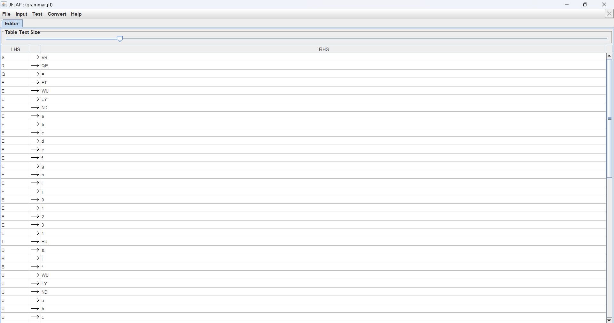
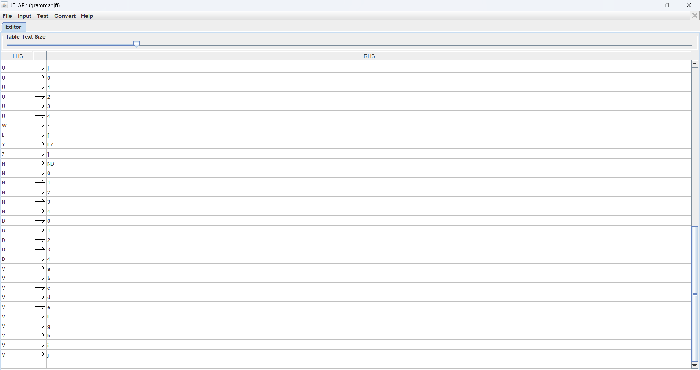

## 5. Алгоритм Кока-Янгера-Касами

Для строки $w = a_1 a_2 \ldots a_n$ строится треугольная таблица синтаксического анализа (ТСА), ячейка $t_{ij}$ которой содержит все нетерминалы, из которых выводится подстрока длины $j$, начинающаяся с $a_i$:
* $t_{i1} = \{A \mid A \to a_i \in P\}$;
* $t_{ij} = \{A \mid A \to BC \in P,\ \exists k,\ 1 \le k < j:\ B \in t_{ik},\ C \in t_{i+k,\,j-k}\}$.

Строка принадлежит языку тогда и только тогда, когда $S \in t_{1n}$. Время работы $O(n^3)$, память $O(n^2)$.

**Пример: ТСА для строки `j=a&b`** (n = 5; строки таблицы соответствуют длине подстроки j, столбцы - начальной позиции i):

| j \ i | 1 `j` | 2 `=` | 3 `a` | 4 `&` | 5 `b` |
| :---: | :---: | :---: | :---: | :---: | :---: |
| 5 | **S** |  |  |  |  |
| 4 | ∅ | R |  |  |  |
| 3 | S | ∅ | E |  |  |
| 2 | ∅ | R | ∅ | T |  |
| 1 | E, U, V | Q | E, U, V | B | E, U, V |

Пояснение для некоторых ячеек:
* $t_{42} = \{T\}$ (`&b`): $B \in t_{41}$, $U \in t_{51}$ и $T \to BU$;
* $t_{33} = \{E\}$ (`a&b`): разбиение `a` + `&b`, $E \in t_{31}$, $T \in t_{42}$ и $E \to ET$;
* $t_{13} = \{S\}$ (`j=a`): $V \in t_{11}$, $R \in t_{22}$ и $S \to VR$, это допустимая строка `j=a`;
* $t_{24} = \{R\}$ (`=a&b`): $Q \in t_{21}$, $E \in t_{33}$ и $R \to QE$;
* $t_{15} = \{S\}$: $V \in t_{11}$, $R \in t_{24}$ и $S \to VR$. Аксиома в верхней ячейке, строка допускается.

Восстановление дерева разбора (процедура REDUCE) дает левый вывод:
$$S \Rightarrow VR \Rightarrow jR \Rightarrow jQE \Rightarrow j{=}E \Rightarrow j{=}ET \Rightarrow j{=}aT \Rightarrow j{=}aBU \Rightarrow j{=}a\&U \Rightarrow j{=}a\&b$$

## 6. Распознавание тестовых строк в JFLAP (Input → CYK Parse)

**Допускаемые строки:**

| № | Строка | Что проверяет | Снимок |
| :---: | --- | --- | :---: |
| 1 | `a=b` | простейшее присваивание | 3 |
| 2 | `c=304` | многозначная пятеричная константа | 4 |
| 3 | `d=~e` | унарная операция | 5 |
| 4 | `j=a&b` | бинарная операция | 6 |
| 5 | `b=a\|3^c` | цепочка бинарных операций одного приоритета | 7 |
| 6 | `e=~(a\|10)&b` | унарная операция над скобками | 8 |
| 7 | `f=(g^~h)\|(4&i)` | две группы скобок | 9 |
| 8 | `a=~~0` | повторная унарная операция | 10 |
| 9 | `h=((c))` | вложенные скобки | 11 |
| 10 | `g=1234^~(a&(b\|c))` | длинное выражение, вложенность | 12 |

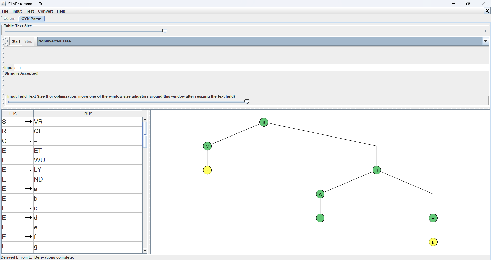
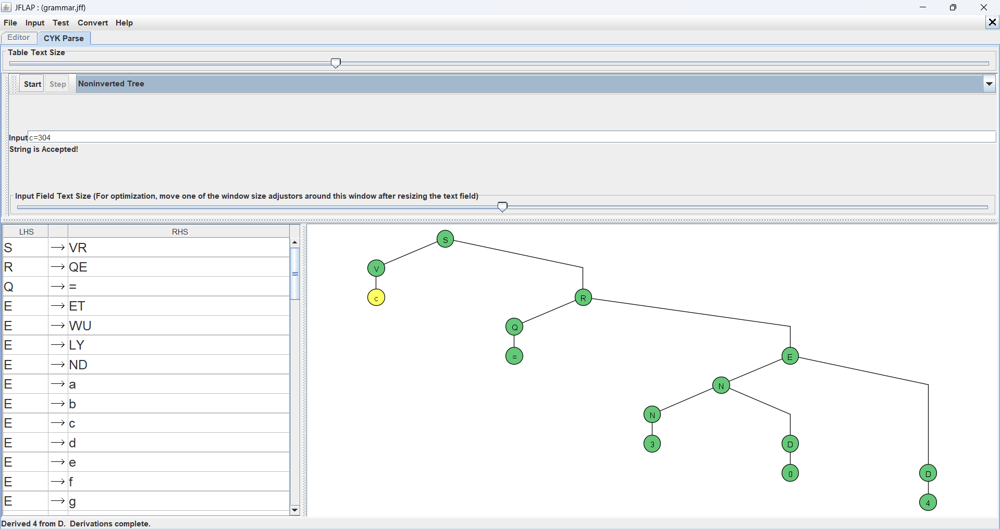
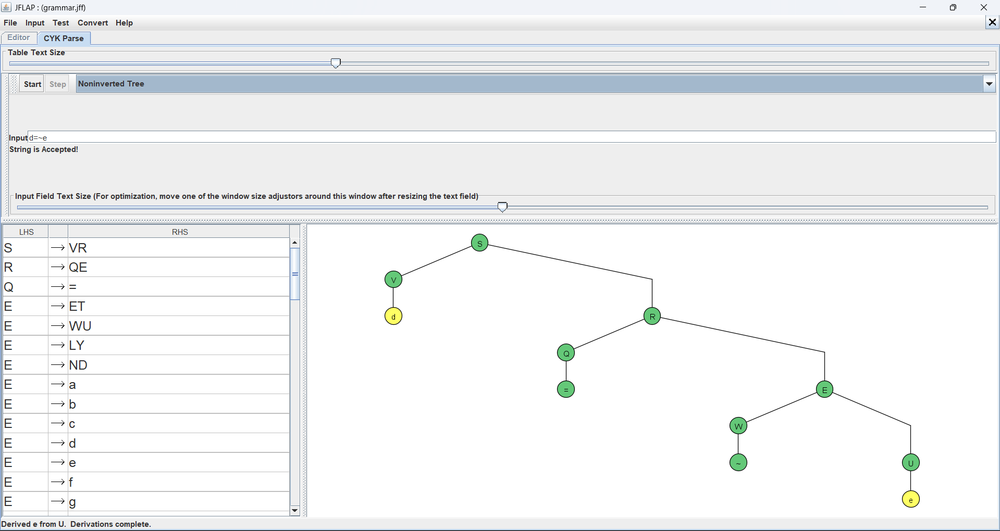
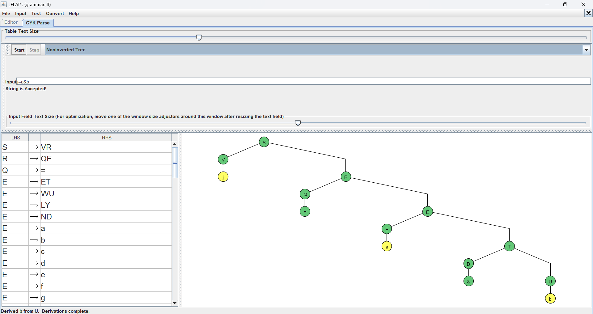
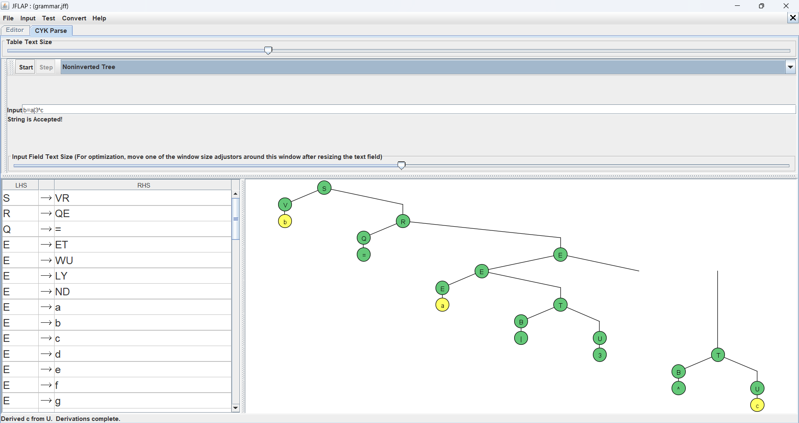
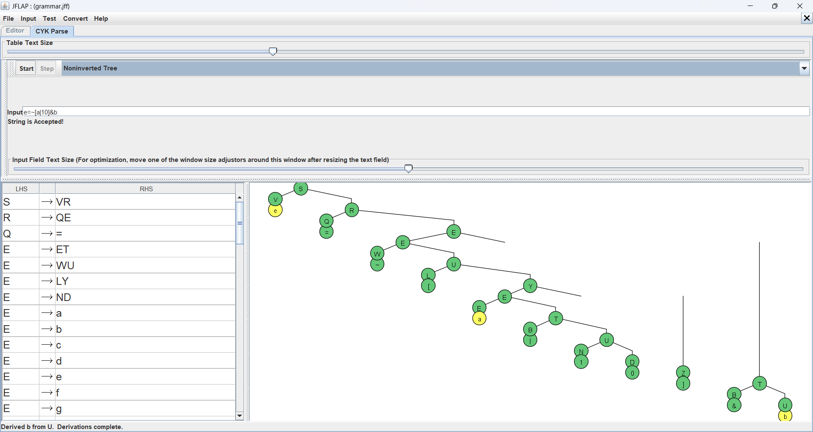
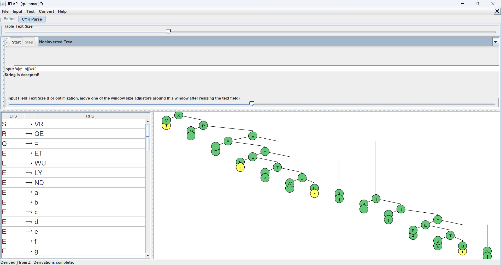
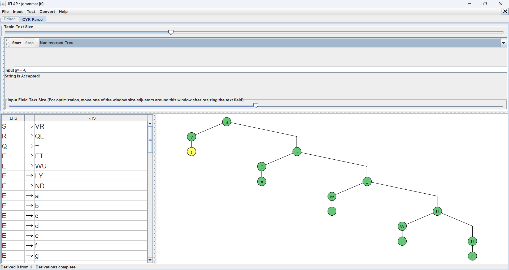
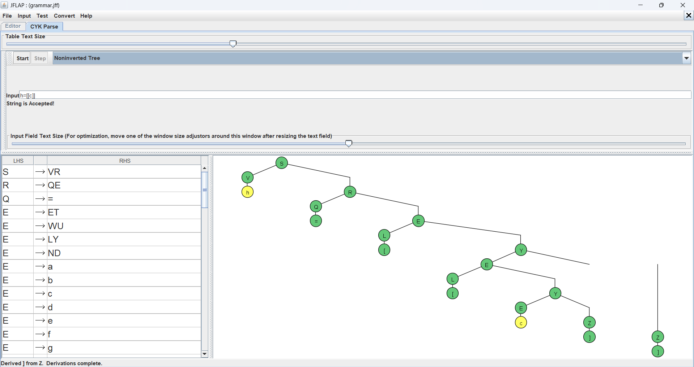
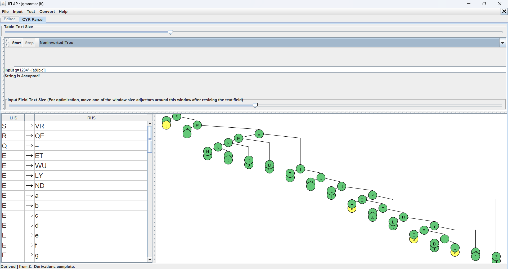

**Отвергаемые строки:**

| № | Строка | Почему не принадлежит языку | Снимок |
| :---: | --- | --- | :---: |
| 11 | `a=b&` | у бинарной операции нет второго операнда | 13 |
| 12 | `3=a` | слева от `=` константа, а не переменная | 14 |
| 13 | `a=(b\|c` | не закрыта скобка | 15 |
| 14 | `a=b~c` | `~` использована как бинарная операция | 16 |
| 15 | `a=b=c` | два присваивания в одной строке | 17 |

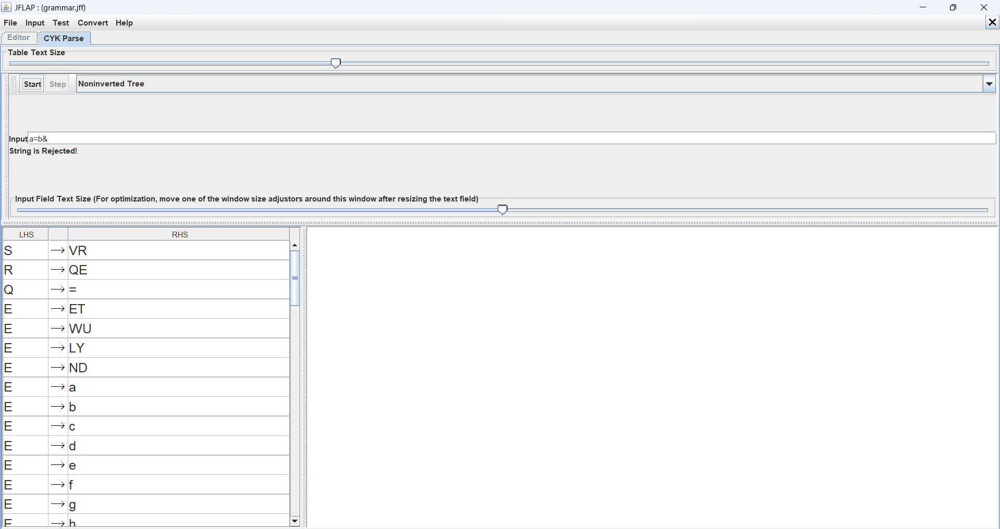

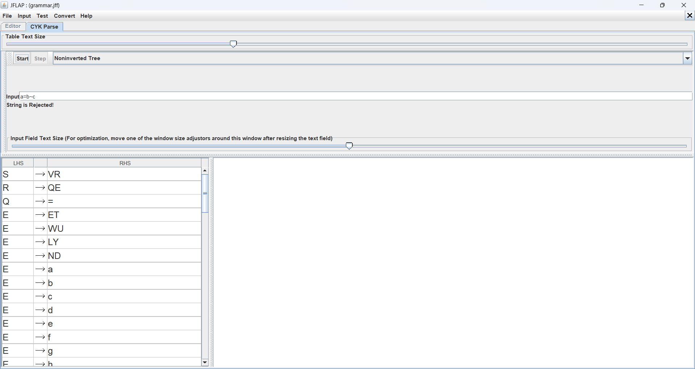

**Проверка на наборе строк (Input → Multiple CYK Parse):** допускаются все 10 строк первой таблицы, отвергаются строки второй таблицы, а также `ab=c`, `a=()`, `a=b&|c`.

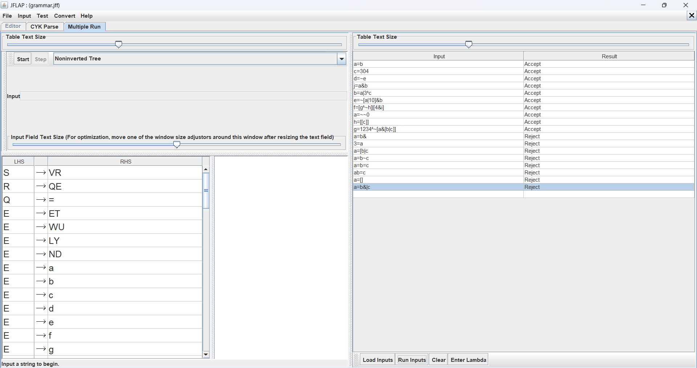

Дополнительно грамматика проверена программно: разбор алгоритмом CYK по `grammar.jff` сравнивался с эталонным распознавателем языка (рекурсивный спуск по исходной грамматике) на всех строках длины до 4 над полным алфавитом, всех строках длины до 6 над алфавитом {a, 0, =, (, ), ~, &} и 20 000 случайных строках длины до 25. Всего 402 668 строк, расхождений нет.

---

## Выводы
Для языка операторов присваивания с «побитовыми» выражениями над пятеричными константами и переменными a–j построена однозначная КСГ, в которой приоритеты операций заданы уровнями нетерминалов, а левоассоциативность бинарных операций - левой рекурсией. Грамматика приведена к нормальной форме Хомского устранением цепных продукций, заменой терминалов в длинных правых частях и разбиением правых частей длины 3 на пары. Полученная грамматика из 14 нетерминалов и 69 продукций разбирается в JFLAP алгоритмом Кока-Янгера-Касами: правильные операторы допускаются, ошибочные (незакрытые скобки, лишние операции, неверная левая часть, символы вне алфавита) отвергаются. Алгоритм CYK универсален для любых КСГ в НФХ и работает за время $O(n^3)$, что подтверждено ручным построением ТСА для строки `j=a&b`.
